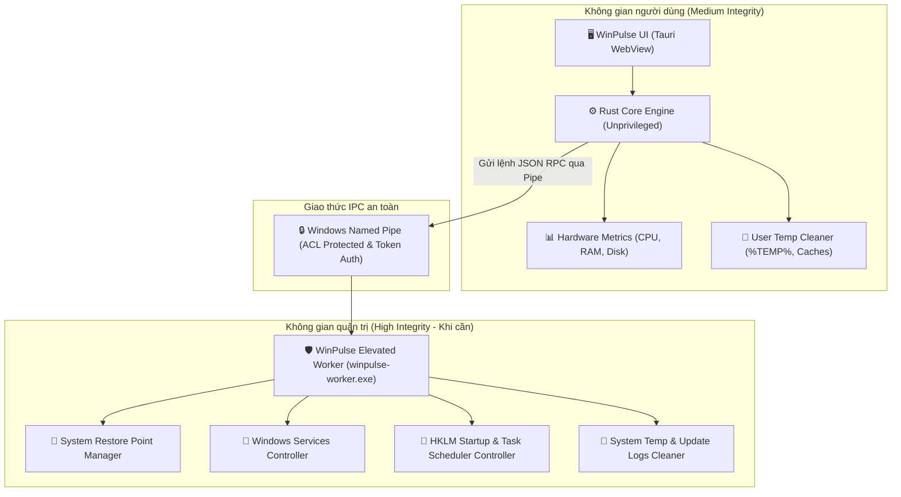
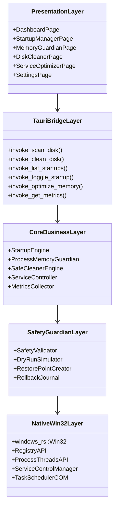
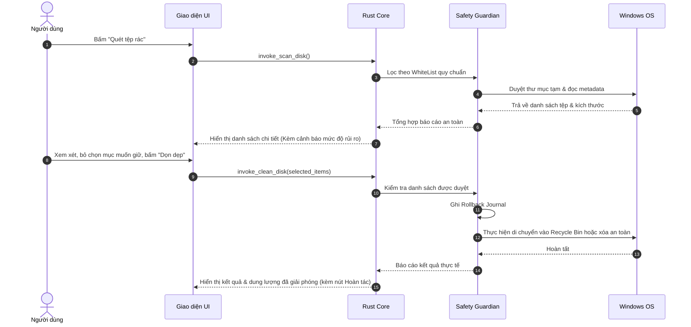

# 🏗️ Phân tích kiến trúc hệ thống (ARCHITECTURE.md)

Tài liệu này phân tích chi tiết quyết định kiến trúc, mô hình bảo mật phân tách đặc quyền, giao thức truyền thông giữa các thành phần và lý do lựa chọn công nghệ cho **WinPulse Optimizer**.

---

## 1. So sánh & Lựa chọn Tech Stack

Khi xây dựng một phần mềm tiện ích hệ thống (System Utility) trên Windows, việc chọn công nghệ quyết định 80% sự thành bại của sản phẩm (dung lượng nhẹ, không ngốn tài nguyên, an toàn và dễ thiết kế UI đẹp).

| Tiêu chí | Tauri v2 + Rust | C# .NET 8 + WinUI 3 | Electron + Node.js | Python + PySide6 |
| :--- | :--- | :--- | :--- | :--- |
| **Mức tiêu thụ RAM chạy nền** | **Cực thấp (~15 - 25 MB)** | Thấp (~60 - 90 MB) | Nặng (~120 - 250 MB) | Trung bình (~70 - 110 MB) |
| **Kích thước file cài đặt (.exe)** | **Rất nhỏ (~8 - 15 MB)** | Trung bình (~50 - 120 MB) | Nặng (~85 - 160 MB) | Nặng (~60 - 100 MB) |
| **Giao tiếp Windows API / Native** | **Cực mạnh (thông qua `windows-rs`)** | Tốt nhất (Microsoft native) | Kém (phải qua C++ Addon) | Kém/Chậm (phải qua `ctypes`/`win32api`) |
| **Khả năng thiết kế UI hiện đại** | **Vô hạn (Web tech: Svelte/React/CSS)** | Khá tốt (XAML, Fluent Design) | Vô hạn (Web tech) | Khá thô / Khó tùy biến giao diện |
| **Tốc độ khởi động app** | **Gần như tức thì (< 0.5s)** | Nhanh (~1s) | Chậm (~2.5 - 4s) | Khá chậm (~2s) |
| **Rủi ro nhận nhầm virus (False-Positive)** | **Thấp (Binary C-ABI tiêu chuẩn)** | Rất thấp (Signed .NET) | Thấp | Rất cao (PyInstaller rất dễ dính virus alert) |

👉 **Quyết định kiến trúc:** Chọn **Tauri v2 + Rust Backend + Frontend Svelte/React**.
- **Rust Core**: Đảm bảo an toàn bộ nhớ (Memory Safety), không có Garbage Collection dừng đột ngột, thao tác trực tiếp với Win32 API với hiệu năng tối đa.
- **Tauri Shell**: Sử dụng Webview2 có sẵn trên Windows 10/11, không phải nhúng kèm Chromium như Electron, giúp tiết kiệm bộ nhớ tối đa.
- **Modern Web Frontend**: Cho phép tự do tạo giao diện glassmorphism, biểu đồ động và micro-interactions đẳng cấp.

---

## 2. Mô hình bảo mật 2 tiến trình (Privilege Separation Architecture)

> ⚠️ **Trạng thái thực tế (28/10/2026): CHƯA triển khai.** Mã nguồn hiện tại chạy **một tiến trình duy nhất** (`winpulse-optimizer.exe`) ở quyền của người dùng mở app. Không có `winpulse-worker.exe` hay Named Pipe. Các thao tác cần Admin (đổi startup type dịch vụ, tạo Restore Point) trả lỗi `PermissionDenied` rõ ràng khi thiếu quyền. Phần dưới đây là **thiết kế mục tiêu**, được theo dõi như nợ kỹ thuật trong `MEMORY.md`.
>
> Bổ sung: HTTP server `127.0.0.1:1421` (`http_server.rs`) chỉ tồn tại trong bản **debug** để xem UI bằng trình duyệt; chỉ phục vụ GET read-only và kiểm tra `Host`/`Origin`. Bản release không mở cổng mạng nào.

Một lỗi nghiêm trọng của các phần mềm dọn dẹp cũ là **ép toàn bộ ứng dụng chạy dưới quyền Administrator (High Integrity)**. Điều này dẫn đến:
1. Mỗi lần mở app đều phải bấm UAC Yes/No phiền phức.
2. Nếu giao diện hoặc một thư viện bên thứ 3 có lỗ hổng, kẻ tấn công có thể chiếm toàn bộ quyền kiểm soát máy tính.

**WinPulse áp dụng mô hình bảo mật chuẩn doanh nghiệp (Privilege Separation):**

### Nguyên tắc vận hành của cơ chế tách quyền:
1. **Khởi động bình thường**: Ứng dụng khởi động ngay lập tức dưới quyền người dùng thông thường (`winpulse-ui.exe`). Người dùng theo dõi phần cứng, dọn dẹp cache cá nhân hoàn toàn không cần cấp quyền Admin.
2. **Kích hoạt Worker khi cần (On-Demand Elevation)**:
   - Khi người dùng muốn tối ưu sâu (can thiệp Windows Services, dọn dẹp thư mục Windows hệ thống, sửa Task Scheduler hệ thống), UI sẽ kiểm tra xem Worker đã chạy chưa.
   - Nếu chưa, UI sẽ gọi `ShellExecuteEx` với động từ `"runas"` để khởi chạy `winpulse-worker.exe`. Popup UAC chỉ xuất hiện duy nhất 1 lần lúc này.
3. **Kênh truyền thông IPC bảo mật**:
   - Giao tiếp qua **Windows Named Pipe** cục bộ (`\\.\pipe\WinPulse-IPC-{UUID}`).
   - Thiết lập **DACL (Discretionary Access Control List)** chỉ cho phép chính tài khoản người dùng hiện tại kết nối.
   - Sử dụng bắt tay xác thực (Handshake Token) ngẫu nhiên để chống giả mạo lệnh từ các phần mềm độc hại khác.

---

## 3. Kiến trúc phân tầng (Layered Architecture)

### 1. Presentation Layer (Giao diện người dùng)
- Viết bằng TypeScript, TailwindCSS và framework UI gọn nhẹ (Svelte 5 / React).
- Quản lý trạng thái thông suốt bằng Stores, giao tiếp phản hồi thời gian thực qua Events từ Rust.

### 2. Tauri Bridge Layer (Cầu nối IPC UI - Backend)
- Các macro `#[tauri::command]` chịu trách nhiệm validate dữ liệu đầu vào từ UI, xử lý lỗi an toàn và ánh xạ thành kiểu dữ liệu Rust an toàn (Strongly-typed DTOs).

### 3. Core Business Layer (Tầng nghiệp vụ lõi)
- Nơi triển khai logic phân tích:
  - Phân tích độ an toàn của từng mục startup.
  - Phân tích tình trạng chiếm dụng bộ nhớ của các process.
  - Quét dung lượng các thư mục tệp tạm.

### 4. Safety Guardian Layer (Tầng bảo vệ an toàn - Trọng tâm của WinPulse)
- **Tuyệt đối không có hành động ghi/xóa nào được đi tắt qua tầng này.**
- Mọi thao tác đều phải qua:
  1. `SafetyValidator`: Kiểm tra xem đường dẫn file có nằm trong "Danh sách cấm chạm" (Blacklist: System32, Boot, Registry quan trọng) không.
  2. `DryRunSimulator`: Giả lập hành động, tính toán chính xác dung lượng và số tệp sẽ can thiệp.
  3. `RestorePointCreator`: Tự động gọi API Windows để tạo điểm phục hồi trước khi sửa đổi cấu hình dịch vụ hoặc Registry.
  4. `RollbackJournal`: Ghi lại nhật ký thay đổi để người dùng có thể bấm "Undo" (Khôi phục lại như cũ) bất cứ lúc nào.

### 5. Native Win32 Layer (Tầng tương tác OS)
- Sử dụng các API chuẩn chính thức của Microsoft thông qua crate `windows` (thay vì chạy các lệnh `cmd.exe` hay script PowerShell lén lút dễ bị Antivirus chặn):
  - `SetProcessInformation` với `PROCESS_POWER_THROTTLING_EXECUTION_SPEED` để kích hoạt Windows Efficiency Mode.
  - `SRSetRestorePointW` để tạo System Restore Point.
  - Service Control Manager APIs (`OpenSCManagerW`, `ChangeServiceConfigW`) để quản lý dịch vụ.
  - COM interfaces cho Task Scheduler (`ITaskService`, `ITaskFolder`).

---

## 4. Luồng xử lý dữ liệu chuẩn (Standard Data Workflow)

Mọi tính năng dọn dẹp hoặc tối ưu trong WinPulse đều tuân thủ chặt chẽ chu trình 5 bước:

