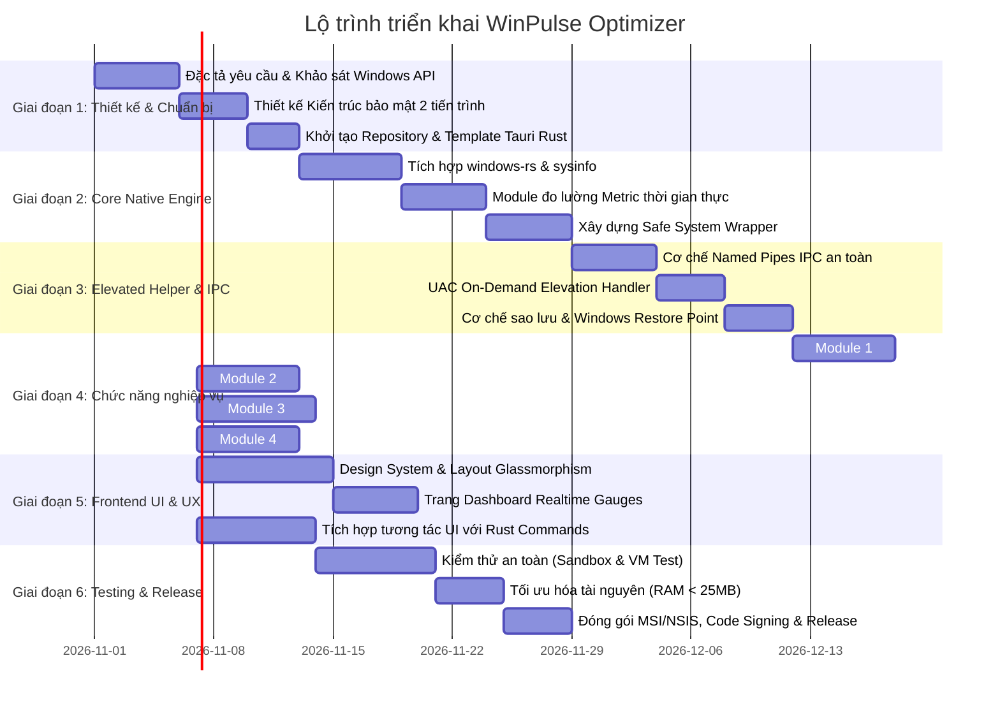

# 📅 Kế hoạch triển khai dự án WinPulse Optimizer (PLAN.md)

Tài liệu này vạch ra lộ trình phát triển toàn diện, chia theo từng giai đoạn (Phases & Sprints), có tiêu chí nghiệm thu rõ ràng (Definition of Done) và kế hoạch kiểm thử an toàn.

---

## 🎯 Mục tiêu cốt lõi (Milestone Targets)

1. **Giai đoạn 1**: Thiết lập nền móng kiến trúc, đặc tả kỹ thuật và mô hình bảo mật.
2. **Giai đoạn 2**: Xây dựng Core Engine (Rust) giao tiếp trực tiếp với Windows API.
3. **Giai đoạn 3**: Triển khai cơ chế tách quyền (Elevated Worker IPC) cho các tác vụ cần Administrator.
4. **Giai đoạn 4**: Phát triển từng module chức năng (Startup, RAM/CPU Guardian, Disk Cleaner, Services).
5. **Giai đoạn 5**: Xây dựng giao diện Desktop hiện đại (Tauri v2 + Frontend UI cao cấp).
6. **Giai đoạn 6**: Kiểm thử tính an toàn (Safety Stress Test), đo lường hiệu năng thực tế và đóng gói.

---

## 🗺️ Lộ trình chi tiết từng giai đoạn

---

## 📋 Chi tiết các công việc theo từng Sprint

### Sprint 1: Architecture, Core Engine & Native Bindings
- [ ] Khởi tạo dự án Tauri v2 với template Rust + Vite/TypeScript.
- [ ] Cài đặt các thư viện Rust cốt lõi: `windows` (crate chính thức từ Microsoft), `sysinfo`, `tokio`, `serde`, `tracing`.
- [ ] Viết abstraction cho việc lấy thông số phần cứng:
  - CPU usage per core và tổng quan.
  - RAM usage (Physical, Virtual, Committed, Cache).
  - Disk I/O read/write throughput per process.
  - Network I/O real-time.
- [ ] **Tiêu chí nghiệm thu (DoD)**: Lấy được số liệu tài nguyên máy tính với chu kỳ 1s/lần, mức tiêu thụ CPU của app lúc đo < 0.2%, RAM < 15MB.

### Sprint 2: Privilege Separation (Kiến trúc 2 tiến trình an toàn)
- [ ] Xây dựng `winpulse-ui` (chạy quyền người dùng thông thường - Medium Integrity).
- [ ] Xây dựng `winpulse-worker` (chạy quyền Administrator - High Integrity, chỉ khởi chạy khi có tác vụ cần quyền).
- [ ] Thiết lập kênh giao tiếp **Windows Named Pipe** có xác thực Token an toàn (chỉ chấp nhận connection từ chính tiến trình UI).
- [ ] Thư viện kích hoạt **System Restore Point** thông qua Windows `SRSetRestorePointW` API trước khi thực hiện bất kỳ thay đổi cấu hình nào.
- [ ] **Tiêu chí nghiệm thu (DoD)**: Người dùng có thể khởi chạy app mà không bị popup UAC làm phiền; chỉ khi nhấn "Dọn dẹp tệp hệ thống" hoặc "Tắt dịch vụ", popup UAC mới xuất hiện 1 lần duy nhất cho worker.

### Sprint 3: Functional Modules - Dọn dẹp & Quản lý tiến trình
- [ ] **Module Startup Manager**:
  - Đọc `HKCU\Software\Microsoft\Windows\CurrentVersion\Run`.
  - Đọc `HKLM\Software\Microsoft\Windows\CurrentVersion\Run`.
  - Đọc thư mục `Startup` người dùng và máy (`shell:startup`, `shell:common startup`).
  - Phân tích Task Scheduler có trigger `OnLogon`.
  - Cho phép Bật/Tắt mà KHÔNG xóa hẳn (chuyển sang cờ `Disabled` chuẩn Windows).
- [ ] **Module Memory & Process Guardian**:
  - Nhận diện các ứng dụng chiếm dụng RAM cao khi đang chạy ẩn (Background).
  - Áp dụng chuẩn **Windows Efficiency Mode** (`SetProcessInformation` với `PROCESS_POWER_THROTTLING_EXECUTION_SPEED`).
  - Hỗ trợ giải phóng Working Set chỉ khi ứng dụng thực sự đã thu nhỏ hoặc vào trạng thái nhàn rỗi (idle) lâu ngày.
- [ ] **Module Safe Disk Cleaner**:
  - Dọn User Temp (`%TEMP%`), Crash Dumps (`%LOCALAPPDATA%\CrashDumps`), Log tệp rác.
  - Dọn Browser Cache (Chrome, Edge, Brave) khi trình duyệt đóng.
  - Phân loại 3 cấp độ: **Safe (An toàn 100%)**, **Caution (Cần xác nhận)**, **System (Cần quyền Admin)**.
- [ ] **Tiêu chí nghiệm thu (DoD)**: Tất cả module đều có hàm `dry_run` (quét thử, báo trước dung lượng giải phóng và danh sách file) trước khi người dùng nhấn thực thi.

### Sprint 4: Frontend UI Cao Cấp & Trải nghiệm người dùng
- [ ] Xây dựng Dashboard hiển thị trực quan thông số máy tính:
  - Đồng hồ Gauge / Area Chart mượt mà 60 FPS cho CPU, RAM, Disk, Network.
  - Thẻ thông báo tình trạng sức khỏe máy tính (Health Score).
  - Nút "Quick Boost" (Tối ưu nhanh 1 chạm) có animation phản hồi sinh động.
- [ ] Giao diện danh sách tiến trình & tệp rác:
  - Cho phép chọn/bỏ chọn từng mục linh hoạt.
  - Bộ lọc tìm kiếm thời gian thực.
  - Chú thích rõ ràng chức năng của từng file/tiến trình (tránh người dùng hoang mang).
- [ ] Hỗ trợ Dark/Light Theme đồng bộ theo hệ điều hành.
- [ ] **Tiêu chí nghiệm thu (DoD)**: Giao diện đạt chuẩn thiết kế chuyên nghiệp, không giật lag, đạt điểm tương tác người dùng cao.

### Sprint 5: Testing, Benchmarking & Release
- [ ] Kiểm thử trên máy ảo Windows 10 và Windows 11 sạch.
- [ ] Kiểm thử tương thích với Windows Defender và các phần mềm diệt virus phổ biến (đảm bảo không bị nhận diện nhầm - False Positive).
- [ ] Đo lường hiệu năng trước và sau tối ưu (thời gian khởi động máy, dung lượng RAM trống, tốc độ phản hồi).
- [ ] Đóng gói bộ cài đặt nhẹ (dưới 15MB) sử dụng NSIS/MSI.
- [ ] **Tiêu chí nghiệm thu (DoD)**: Bộ cài hoàn chỉnh, hoạt động ổn định, không gây crash hệ thống, có tài liệu hướng dẫn sử dụng.
